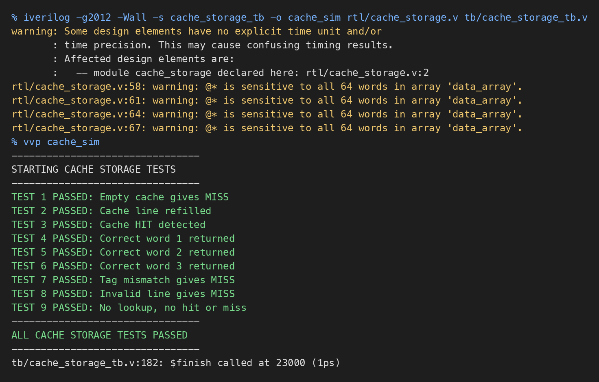

# Cache Storage and Hit/Miss Detection

Files: `rtl/cache_storage.v`, `tb/cache_storage_tb.v`

## 1. Cache Lines

The cache has 64 lines (0 to 63). Each line stores:

- Data: 128 bits (four 32-bit words)
- Tag: 22 bits
- Valid bit: 1 bit (0 = empty, 1 = has data)

## 2. Storage Arrays

```verilog
reg [127:0] data_array [0:63];
reg [21:0]  tag_array  [0:63];
reg         valid_array [0:63];
```

The index from the address decoder selects one line in all three arrays.

## 3. Tag Comparison

The tag stored in the selected line is compared with the requested tag:

```verilog
assign tag_match = (tag_array[lookup_index] == lookup_tag);
```

## 4. Hit and Miss

```verilog
assign hit  = lookup_valid && valid_array[lookup_index] && tag_match;
assign miss = lookup_valid && !hit;
```

A hit happens only when the line is valid and the tag matches. Otherwise it is a miss.

Example: address `0x24` gives tag 0, index 2, word index 1. If line 2 is valid and its tag is 0, it is a hit and word 1 is returned.

## 5. Word Selection

On a hit, `word_index` selects one word from the 128-bit block:

| word_index | Bits |
|---|---|
| 00 | [31:0] |
| 01 | [63:32] |
| 10 | [95:64] |
| 11 | [127:96] |

## 6. Cache Refill

When `fill_valid` is 1, on the clock edge the block, its tag and valid bit = 1 are written into line `fill_index`. Reset clears all valid bits.

## 7. Simulation Results

```
iverilog -g2012 -Wall -s cache_storage_tb -o cache_sim rtl/cache_storage.v tb/cache_storage_tb.v
vvp cache_sim
```

All 9 tests passed: miss on an empty cache, refill, hit, reading all four words, miss on a tag mismatch, miss on an empty line, and no hit or miss when there is no lookup.


