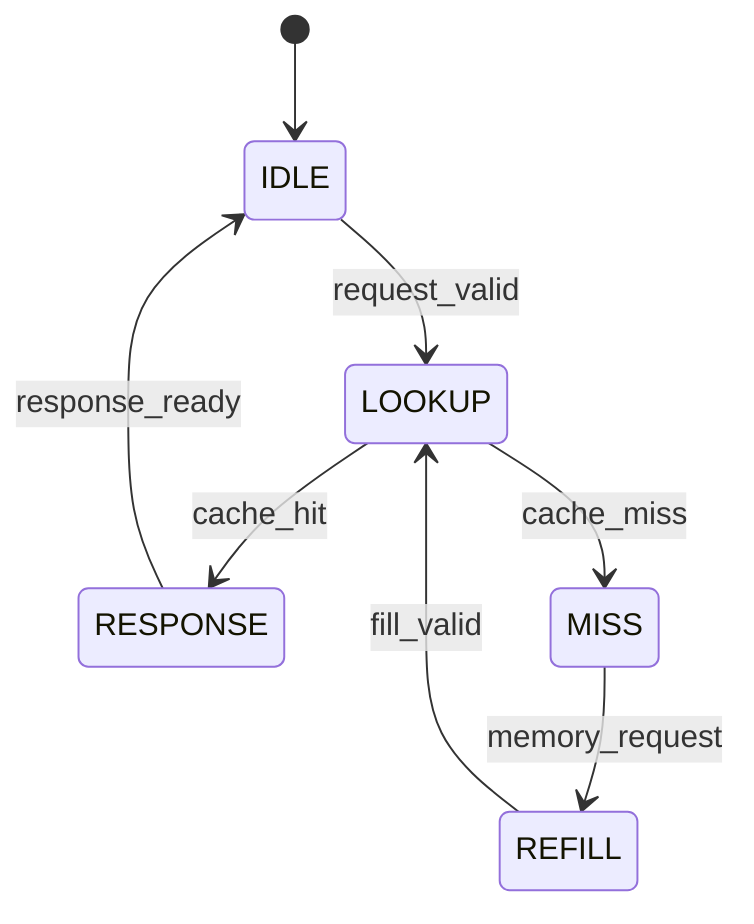

# Cache Controller FSM Design

## 1. Introduction

The Cache Controller is responsible for coordinating CPU memory
requests, cache lookup operations, cache misses, memory block
refill operations, and CPU responses.

It uses a Finite State Machine (FSM) to control the complete
operation of the direct-mapped cache.

The controller consists of five states:

1. IDLE
2. LOOKUP
3. MISS
4. REFILL
5. RESPONSE

---

## 2. FSM State Descriptions

| State | Binary Code | Description |
|---|---|---|
| IDLE | 000 | Waits for a valid CPU request |
| LOOKUP | 001 | Checks whether the requested data is in cache |
| MISS | 010 | Initiates a main memory block refill |
| REFILL | 011 | Waits for the memory interface to provide the block |
| RESPONSE | 100 | Returns the requested data to the CPU |

### 2.1 IDLE State

- The controller waits for `request_valid`.
- `request_ready` is asserted.
- When a CPU request arrives, its address is saved.
- The controller transitions to LOOKUP.

### 2.2 LOOKUP State

- The address decoder extracts the tag, index, and word offset.
- Cache storage compares the requested tag with the stored tag.
- If the cache reports a hit, the requested word is saved and
  the controller transitions to RESPONSE.
- If the cache reports a miss, the controller transitions to MISS.

### 2.3 MISS State

- The controller generates a one-cycle `memory_request` pulse.
- The saved CPU address is sent to the memory interface.
- The controller transitions to REFILL.

### 2.4 REFILL State

- The memory interface fetches four consecutive 32-bit words.
- The four words are combined into a 128-bit cache block.
- Cache storage writes the block when `fill_valid` is asserted.
- The controller returns to LOOKUP to check the refilled block.

### 2.5 RESPONSE State

- The requested 32-bit word is presented on `response_data`.
- `response_valid` remains asserted.
- The controller waits until `response_ready` is asserted.
- Once the CPU accepts the response, the controller returns to IDLE.

---

## 3. FSM State Transition Diagram

---

## 4. State Transition Table

| Current State | Condition | Next State |
|---|---|---|
| IDLE | request_valid = 0 | IDLE |
| IDLE | request_valid = 1 | LOOKUP |
| LOOKUP | cache_hit = 1 | RESPONSE |
| LOOKUP | cache_miss = 1 | MISS |
| MISS | Request issued | REFILL |
| REFILL | fill_valid = 0 | REFILL |
| REFILL | fill_valid = 1 | LOOKUP |
| RESPONSE | response_ready = 0 | RESPONSE |
| RESPONSE | response_ready = 1 | IDLE |

---

## 5. Address Organization

The cache uses a 32-bit address divided into three fields.

| Address Field | Bit Positions | Width |
|---|---|---|
| Tag | [31:10] | 22 bits |
| Index | [9:4] | 6 bits |
| Offset | [3:0] | 4 bits |

The word index is extracted from address bits [3:2].

---

## 6. Cache Block Refill

Each cache block contains four 32-bit words.

Block size:

4 words x 32 bits = 128 bits

Total block size = 16 bytes.

For a request to address 0x24, the memory interface fetches:

| Word | Address |
|---|---|
| Word 0 | 0x20 |
| Word 1 | 0x24 |
| Word 2 | 0x28 |
| Word 3 | 0x2C |

The resulting 128-bit block is stored in cache storage.

After refill, the controller returns to LOOKUP to retrieve the requested word.

---

## 7. Important Control Signals

| Signal | Function |
|---|---|
| request_valid | Indicates a CPU request |
| request_ready | Indicates controller can accept a request |
| lookup_valid | Enables cache lookup |
| cache_hit | Indicates requested data is present |
| cache_miss | Indicates requested data is absent |
| memory_request | Initiates memory refill |
| fill_valid | Indicates cache block refill is being written |
| response_valid | Indicates response data is available |
| response_ready | Indicates CPU accepts response |

---

## 8. Reset Operation

When `reset` is asserted:

- The FSM returns to IDLE.
- The saved address is cleared.
- Response data is cleared.
- The controller waits for a new CPU request.

---

## 9. Verification

The FSM is verified using the cache controller testbench.

The testbench checks:

1. Correct reset behavior.
2. Initial cache miss detection.
3. Memory refill operation.
4. Correct response data.
5. Cache hit on repeated access.
6. Correct retrieval of different words in the same block.
7. Response handshake behavior.

Simulation waveforms are generated using:

`$dumpfile("cache_controller.vcd");`

The waveform can be inspected using GTKWave.

---

## 10. Conclusion

The Cache Controller FSM coordinates the CPU, address decoder,
cache storage, memory interface, and main memory.

It handles cache hits and misses, initiates block refill
operations, and returns the requested data to the CPU.

The five-state FSM provides an organized control mechanism
for the direct-mapped cache architecture.
